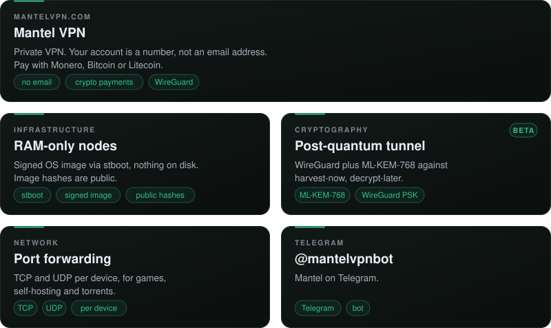
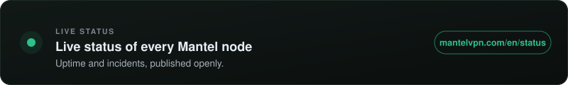

  
  <h3>Mantel</h3>
  Private VPN · no email sign-up · <a href="https://mantelvpn.com">mantelvpn.com</a>
    
  

  <h3>ENGINEERING STACK</h3>
  &nbsp;&nbsp;&nbsp;
  &nbsp;&nbsp;&nbsp;
  <picture>
    <source media="(prefers-color-scheme: dark)" srcset="https://cdn.simpleicons.org/nextdotjs/ffffff">
    
  </picture>&nbsp;&nbsp;&nbsp;
  &nbsp;&nbsp;&nbsp;
  <picture>
    <source media="(prefers-color-scheme: dark)" srcset="https://cdn.simpleicons.org/rust/ffffff">
    
  </picture>&nbsp;&nbsp;&nbsp;
  &nbsp;&nbsp;&nbsp;
  &nbsp;&nbsp;&nbsp;
  <picture>
    <source media="(prefers-color-scheme: dark)" srcset="https://cdn.simpleicons.org/wireguard/ffffff">
    
  </picture>&nbsp;&nbsp;&nbsp;
  &nbsp;&nbsp;&nbsp;
  &nbsp;&nbsp;&nbsp;
  &nbsp;&nbsp;&nbsp;
  &nbsp;&nbsp;&nbsp;
  
    

  <h3>FEATURED PROJECTS</h3>
  

  <h3>STATUS</h3>
  

  <a href="https://mantelvpn.com"><b>Website</b></a> &nbsp;·&nbsp;
  <a href="https://mantelvpn.com/en/status"><b>Status</b></a> &nbsp;·&nbsp;
  <a href="https://mantelvpn.com/news"><b>News</b></a> &nbsp;·&nbsp;
  <a href="https://t.me/mantelvpnbot"><b>Telegram</b></a> &nbsp;·&nbsp;
  <a href="https://mantelvpn.com/en/security"><b>Security</b></a>

